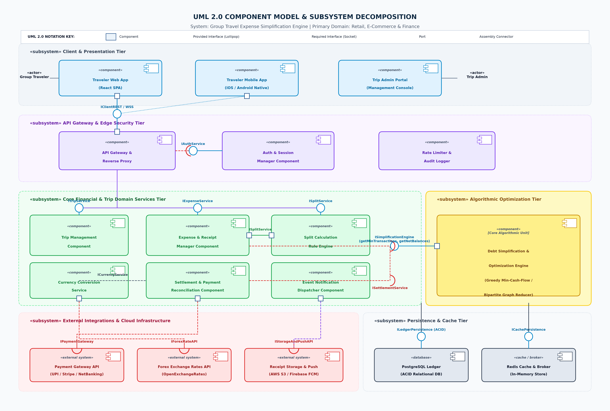

# Lab 3 – Component Modelling & Architectural Pattern Selection

**Course:** UE23CS341A: Software Engineering  
**Department:** Department of Computer Science & Engineering, PES University  
**Student Name:** Sakthevel Saravanan  
**SRN:** PES1UG24CS405  
**Project Title:** Group Travel Expense Simplification Engine  
**Primary Domain:** Retail, E-Commerce & Finance  
**Target Actors:** Group Traveler, Trip Admin  
**Supporting Actors:** Payment Gateway (UPI / Stripe), Live Forex Rate API, Cloud Storage & Push Notification Service  

---

## 1. Executive Summary & Problem Context

In group travel contexts, travel expenses (lodging, transit, meals, activities) are incurred in a distributed fashion across group members using disparate payment methods and multi-national currencies. At trip completion, determining individual liabilities results in confusing cross-repayments, computation errors, and administrative friction.

The **Group Travel Expense Simplification Engine** solves this problem by providing:
1. **Multi-Currency Expense Ingestion:** Captures trip expenses with diverse split models (equal, exact amounts, percentage shares, itemized exclusion splits) and converts foreign expenses into a standardized trip base currency.
2. **Real-Time Net Balance Computation:** Maintains real-time net balances for each participant:
   $$\text{Net Balance}_i = \sum \text{Paid}_i - \sum \text{Owed}_i$$
   where $\sum \text{Net Balance}_i = 0$.
3. **Debt Simplification & Minimization:** Employs a Greedy Minimum-Cash-Flow graph reduction algorithm to condense $O(N^2)$ pairwise debts down to at most $N-1$ settlement transactions.
4. **Automated Settlement & Reconciliation:** Generates dynamic payment intents (UPI / Stripe) and reconciles payments against an immutable transactional ledger.

---

## 2. Component Decomposition & System Architecture

Applying the core software engineering principles of **High Cohesion**, **Loose Coupling**, and **Information Hiding**, the system is decomposed into autonomous components across six structural tiers:

| Component Name | Provided Interface (Lollipop) | Required Interface (Socket) | Core Responsibility |
| :--- | :--- | :--- | :--- |
| **API Gateway & Edge Router** | `IClientREST`, `IWebSocketStream` | `IAuthService`, `ITripService`, `IExpenseService`, `ISettlementService` | Single client entry point, SSL termination, JWT authentication verification, rate limiting, and reverse proxy routing. |
| **Auth & Identity Manager** | `IAuthService` | `IUserPersistence`, `ITokenStore` | Manages user registration, Argon2id password hashing, JWT sessions, traveler profiles, and payment handles (UPI IDs). |
| **Trip Management Service** | `ITripService` | `ITripPersistence`, `IUserProfileService`, `INotificationService` | Trip creation, member invitations, admin permissions, trip base currency configuration, and trip archival. |
| **Expense & Receipt Manager** | `IExpenseService` | `IExpensePersistence`, `ISplitService`, `ICurrencyService`, `IStorageService` | Central business facade for expenses, receipt image uploads, currency conversion orchestration, and ledger writes. |
| **Split Calculation Rule Engine** | `ISplitService` | *None (Pure Domain Engine)* | Stateless mathematical rule engine for equal, percentage, and exact share splits; verifies $\sum \text{Shares} = \text{Total Amount}$. |
| **Currency Conversion Service** | `ICurrencyService` | `IForexRateAPI`, `IRateCachePersistence` | Converts foreign expenditures to base trip currency via live Forex APIs with Redis caching and offline fallback. |
| **Debt Simplification Engine** *(Core)* | `ISimplificationEngine` | `IExpensePersistence`, `ITripPersistence` | **Algorithmic Core:** Computes net balances vector; executes Greedy Min-Cash-Flow matching to minimize repayment transactions. |
| **Settlement & Reconciliation** | `ISettlementService` | `IPaymentGateway`, `ISimplificationEngine`, `ILedgerPersistence` | Generates dynamic UPI intent links, processes payment webhooks, and reconciles settled balances in the ledger. |
| **Notification Dispatcher** | `INotificationService` | `IStorageAndPushAPI`, `IMessageBroker` | Asynchronous message dispatcher delivering FCM push alerts, SMS, and email summaries for trip events. |
| **Persistence & Database Tier** | `ILedgerPersistence`, `ICachePersistence` | *Storage / File System* | PostgreSQL relational database for ACID financial audit trails + Redis cluster for session states and rapid caching. |

---

## 3. UML 2.0 Component Diagram

The UML 2.0 Component Diagram models component boundaries, lollipop provided interfaces, socket required interfaces, ports, and external infrastructure integrations:

### Key Notational Elements:
- **Lollipop Notation (Circle):** Provided Interface exposing operations implemented by a component.
- **Socket Notation (Semi-Circle Arc):** Required Interface denoting an operational dependency needed by a component.
- **Assembly Connector:** Direct interface binding linking a required interface socket to a provided interface lollipop.
- **Ports (Small Rectangles):** Interaction points through which messages and protocols enter or leave components.
- **Stereotypes:** `«component»`, `«subsystem»`, `«external system»`, `«database»`.

---

## 4. Architectural Pattern Selection & Justification

### 4.1 Evaluation of Candidate Patterns

1. **Monolithic Layered (N-Tier):**
   - *Status:* **Rejected.**
   - *Rationale:* In a monolithic architecture, compute-heavy debt minimization cannot scale independently from I/O-heavy receipt uploads. In addition, latency or outages in external payment/forex gateways risk cascading failures across the entire system.
2. **Model-View-Controller (MVC):**
   - *Status:* **Rejected.**
   - *Rationale:* MVC is an application-level UI pattern, not an enterprise macro-architecture. It does not address asynchronous event processing, third-party payment webhooks, or distributed compute scaling.
3. **Pipes and Filters:**
   - *Status:* **Rejected.**
   - *Rationale:* While suitable for batch data transformation (such as OCR processing of receipts), it is fundamentally incompatible with interactive, bidirectional user queries and real-time ledger reconciliations.
4. **Pure Microservices:**
   - *Status:* **Partially Adopted.**
   - *Rationale:* Offers excellent horizontal scalability and service autonomy, but introducing distributed databases across all boundaries makes ACID financial ledger guarantees fragile without excessive distributed transaction overhead.
5. **Selected Pattern: Modular Layered Microservices with Event-Driven Messaging:**
   - *Status:* **SELECTED.**
   - *Rationale:* Unifies a layered architectural hierarchy with domain-driven microservice boundaries. Provides strict ACID transactional consistency on the financial ledger while enabling horizontal scaling for the algorithmic debt engine and resilient, asynchronous message handling for notifications and external webhooks.

### 4.2 Quality Attribute Trade-Off Matrix

| Quality Attribute | Monolithic Layered | Pure Microservices | Pipes & Filters | Selected Hybrid Architecture |
| :--- | :--- | :--- | :--- | :--- |
| **Horizontal Scalability** | Low (All or nothing) | Very High | Moderate | **Very High (Targeted service scaling)** |
| **Modularity & Cohesion** | Moderate (Degrades over time) | High | High (Filter scope) | **Exceptional (Explicit interfaces)** |
| **Financial ACID Consistency** | Very High (Single DB) | Low (Distributed Sagas) | N/A | **Very High (Unified Ledger DB)** |
| **Fault Isolation & Resilience** | Low (Cascading crashes) | High | Moderate | **High (Circuit Breakers & Queues)** |
| **Algorithm Performance** | Bound to Web Server CPU | High (Dedicated workers) | Moderate | **Optimal (Stateless compute cluster)** |
| **Development Velocity** | High initially, then slows | Moderate (DevOps overhead) | Moderate | **High (Componentized modules)** |
| **Operational Overhead** | Very Low | Very High (K8s / Mesh) | Moderate | **Moderate (Managed cloud services)** |

### 4.3 Detailed Architectural Justification Rationale

1. **High Cohesion & Single Responsibility Principle (SRP):**  
   The `Debt Simplification Engine` contains only mathematical graph reduction algorithms, completely decoupled from UI, persistence, and external gateways. Internal algorithm improvements (e.g. integer linear programming) have zero ripple effects on other modules.
2. **Loose Coupling & Inversion of Control:**  
   Dependencies between components occur strictly through abstract interfaces (`ISimplificationEngine`, `IExpenseService`, `ISplitService`). This enables full unit testability with mock interfaces and isolated component deployments.
3. **Decoupling Compute-Bound vs. I/O-Bound Workloads:**  
   Receipt image handling and transaction queries are I/O bound, whereas bipartite debt minimization for large groups ($50+$ members) is CPU/memory bound. The engine can be deployed onto high-CPU worker instances without competing for web-tier resources.
4. **Fault Isolation & External Gateway Resilience:**  
   External dependencies (Stripe, OpenExchangeRates) are protected via Circuit Breakers and Asynchronous Message Queues. Outages in external APIs never block local expense creation or balance inquiries.
5. **ACID Financial Integrity vs. BASE Notifications:**  
   Core financial tables (Users, Trips, Expenses, Settlements) maintain ACID consistency in a PostgreSQL database. Non-critical notifications and image uploads use eventual consistency (BASE), delivering the optimal balance between safety and performance.

---

## 5. Traceability Matrix: Mapping Lab 1 Use Cases to Components

| Use Case ID & Title | Primary Actor | Realizing Component | Provided Interface | Operational Mechanism |
| :--- | :--- | :--- | :--- | :--- |
| **UC-01 Login** | Group Traveler, Trip Admin | Auth & Session Manager | `IAuthService` | Verifies user credentials, validates MFA, and issues JWT tokens. |
| **UC-02 Manage Trip** | Trip Admin | Trip Management Service | `ITripService` | Creates trip workspace, manages roster, sets base currency. |
| **UC-03 Record Expense** | Group Traveler | Expense & Receipt Manager | `IExpenseService` | Logs expense, converts forex, uploads receipt, updates ledger. |
| **UC-04 Split Expense** | Group Traveler | Split Calculation Engine | `ISplitService` | Calculates individual shares; enforces $\sum \text{Shares} = \text{Amount}$. |
| **UC-05 View Balance** | Group Traveler, Trip Admin | Debt Simplification Engine | `ISimplificationEngine` | Computes net balances and executes Greedy Min-Cash-Flow reduction. |
| **UC-06 Settle Expenses** | Group Traveler, Payment Gateway | Settlement & Payment Component | `ISettlementService` | Launches UPI/Stripe checkout, validates webhooks, settles debts. |
| **UC-07 Notification** | Group Traveler | Event Notification Dispatcher | `INotificationService` | Asynchronously dispatches push alerts, SMS, and trip updates. |

---

## 6. Deliverable Artifacts

- **Primary Submission PDF:** [Lab_3_Component_Modelling_Architectural_Pattern_Selection_Sakthevel_Saravanan.pdf](Lab_3_Component_Modelling_Architectural_Pattern_Selection_Sakthevel_Saravanan.pdf)
- **Component Diagram Image:** [Component_Diagram.png](Component_Diagram.png)
- **Diagram Generation Script:** [generate_diagram.py](generate_diagram.py)
- **PDF Generation Script:** [generate_pdf.py](generate_pdf.py)
